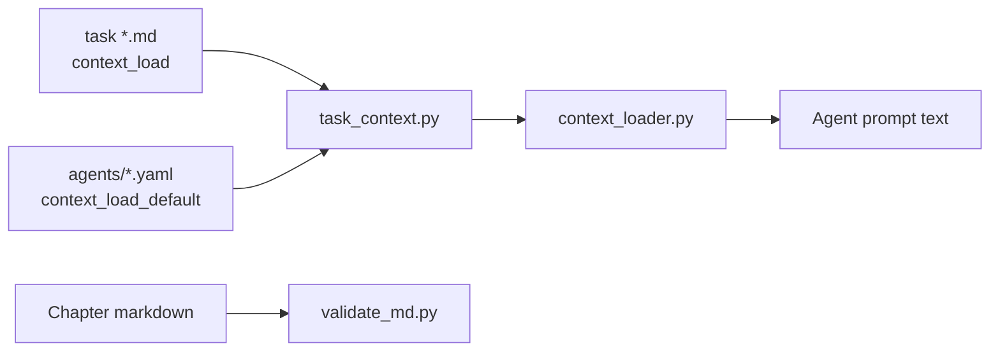

# Application layer — harness processing components

For this book repo, the **application layer** is the Python tooling that
validates canon, assembles agent context, and regression-tests the harness.
No deployable service — scripts invoked locally and in pre-commit.

## Components



| Component | Path | Responsibility |
| :---- | :---- | :---- |
| Markdown validator | `scripts/validate_md.py` | Frontmatter, links, teaching-callout lint, fog words |
| Context loader | `scripts/context_loader.py` | `strip_teaching_blocks`, `load_task_context` |
| Task assembler | `scripts/task_context.py` | Merge agent defaults + task paths; CLI preview |
| Golden tests | `scripts/test_context_loader.py`, `test_task_context.py`, `test_golden_tasks.py` | Regression on strip + evaluator path |
| Playground archive | `scripts/playground_archive.py` | Promote `_playground/` experiments when approved |

## Context assembly contract

1. Read `context_load_default` from assigned agent yaml.
2. Append `context_load` from task frontmatter (deduped, agent first).
3. For each path: read file → strip per [[ADR-006-teaching-block-convention|ADR-006]] → join with `\n\n---\n\n`.
4. Exempt from strip: ADRs, `00-start-here/`, `context/system/sessions/`.

```powershell
python scripts/task_context.py 04-your-agents/tasks/03-populate-context-tree.md
```

## Boundaries

| In scope | Out of scope (other chapters) |
| :---- | :---- |
| Strip algorithm v1.5 | OpenHands runtime (Ch. 05) |
| Fixture tests on canon files | LiteLLM / Langfuse wiring (deferred T8) |
| `validate_md.py --all` gate | Product application code |

## Failure handling

- Validator failure blocks session close — fix or exempt with documented rule.
- Missing `context_load` path → `task_context.py` error; task file is wrong.
- Agent touches file outside **Scope — modify** → escalate; may need Layer 2 edit.
