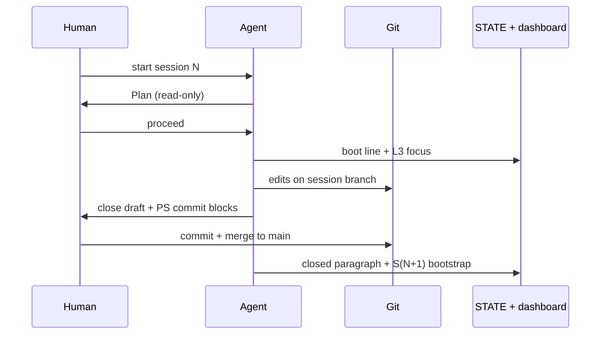

# Communication layer — how harness participants exchange state

For this book repo, **communication** is human ↔ agent ↔ git ↔ canon files.
There is no HTTP API. Messages are chat gates, markdown handoffs, and commits.

## Channels

| Channel | Payload | When |
| :---- | :---- | :---- |
| Chat (Cursor / IDE) | Plan, proceed, review, commit blocks | Session open, build, close |
| `STATE.md` | Boot line, threads, bootstrap | Every session transition |
| `_index/dashboard/` | L1 context · L2 containers · L3 components | Same timestamp as STATE |
| Git branch | Isolated diff | `session-NN/<topic>` from `main` |
| Task `context_load` | Stripped markdown bundle | Agent execution (Ch. 05) |
| Wiki-links | `[[path\|label]]` traversable refs | All canon files |

## Session message flow

## Git rules (D-001)

General rule ([ADR-011](../../../02-design/decisions/ADR-011-host-profile-seam.md)): **git write operations**
run on the **host shell** documented in [constraints/host](../../../03-plan/constraints/host.md) — not in agent
sandboxes where the profile documents a known failure mode.

| Policy | This harness (see host profile) |
| :----- | :------------------------------ |
| Human runs | commit, merge, push on host shell |
| Agent supplies | copy-paste blocks in host **copy-paste block language** |
| Agent must not | commit/push unless human asks; no sandbox git write on Windows |
| Branch ritual | One session branch per topic; delete after merge |
| Commits | Atomic; Conventional Commits |

## Human gates (six-step)

Review tasks use the shape in [Agents](../../../Agents.md) § Human gate:

1. What your review will decide (future tense)
2. Questions you must answer
3. Evidence table
4. Decision rule
5. Human runs git
6. Scope confirmation (past tense)

Session close validates **work diff and** STATE + dashboard + bootstrap together.

## Idempotency and handoff

- Re-running `task_context.py` on the same task yields the same stripped text.
- Bootstrap block in STATE must match dashboard L3 and roadmap row.
- Stale STATE after merge is a harness defect — treat as blocking.

## Harness vs reader product

| This repo | Reader product |
| :---- | :---- |
| Chat + git + markdown | Your APIs, events, webhooks per [communication layer](../../../02-design/layers/communication.md) |
| `session-workflow.md` | Your runbooks and CI notifications |
| D-001 human git | Host shell per `constraints/host.md` — your deployment pipelines |
