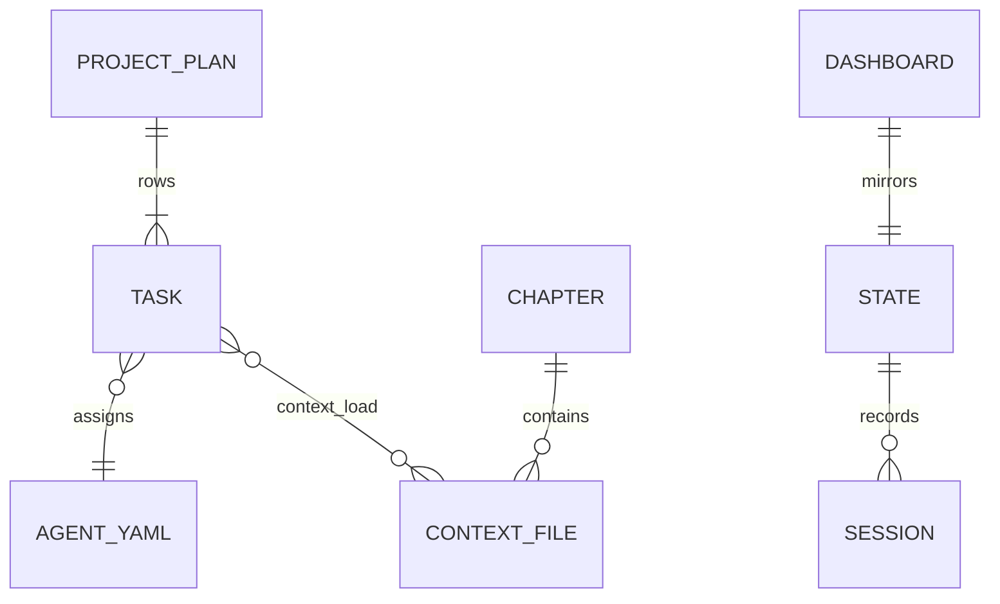

# Data layer — harness canon artifacts

For this book repo, the **data layer** is not a database. It is the set of
durable markdown artifacts agents and humans read and write. Treat them like
schema: hard to change once sessions depend on them.

## Primary stores

| Store | Role | Mutability |
| :---- | :---- | :---- |
| Chapter folders `00`–`08` | Teaching + operational canon | Session branches; merge to `main` |
| `context/system/` | Agent orientation (Layer 1) | Rare; ADR-governed |
| `context/architecture/` | Domain distillations (Layer 2) | When layer design changes |
| `context/implementation/` | Task-narrow context (Layer 3) | Per feature / task |
| `STATE.md` | Current position (10-line truth) | Every session close |
| `_index/dashboard/` | Visual status L1–L3 | Every session close |
| `03-plan/PROJECT-PLAN.md` | Living task table | When tasks add/close |

## Artifact shape

Every canon file carries YAML frontmatter:

| Field | Purpose |
| :---- | :---- |
| `title` | Human + agent label |
| `chapter` or `layer` | Placement in book or system |
| `status` | `template` · `reference` · `living` · `done` |
| `tags` | Loader and human filtering |

Body uses Obsidian `[[wiki-links]]` so paths stay stable when files move.

## Relationships

## Integrity rules

- **Single source of task order:** `03-plan/PROJECT-PLAN.md` table — not duplicate lists in chat.
- **Handoff trio:** `STATE.md` + dashboard L1–L3 + next bootstrap must agree before merge.
- **Teaching vs artifact:** dual-purpose chapter files use `[!LEARN]` / `[!TIP]` / `[!TEACH]`; the [context-loader](../../../04-your-agents/context-loader.md) strips them for agent prompts ([ADR-006](../../../02-design/decisions/ADR-006-teaching-block-convention.md)).
- **No secrets in canon:** API keys live in `.env` (gitignored); `constraints/project.md` holds *names* of models and endpoints only.

## Harness vs reader product

| This repo (harness-meta) | Reader product fork |
| :---- | :---- |
| Markdown files as data | Tables, files, blobs per your [data layer design](../../../02-design/layers/data.md) |
| STATE / dashboard as runtime truth | Your DB + observability store |
| `context/` tree as agent context | Your `context/architecture/` from Ch. 02 |
