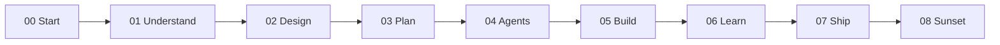

# UX layer — how readers and agents experience the harness

For this book repo, **UX** is the chapter journey: folder names, teaching
callouts, dashboard zoom, and the dual path (scaffold vs fast track). The
"user" is the human following the book and the agent reading canon as context.

## Chapter spine

| Ch | Reader experience goal | Agent load trigger |
| :-- | :---- | :---- |
| 00 | Orient; tools ready | `Agents.md`, manifesto |
| 01 | Roles + use cases | `user-roles.md`, `use-cases.md` |
| 02 | Four layers + ADRs | `02-design/layers/*` |
| 03 | Living PROJECT-PLAN | `PROJECT-PLAN.md`, constraints |
| 04 | Agent team + context tree | `agents/*.yaml`, `context/` |
| 05 | Execute tasks | `openhands.md`, `task_context.py` |
| 06 | Learn loop | boilerplate, post-mortems (S23) |
| 07–08 | Ship / sunset stubs | runbook scope only |

## Dual path

Every demanding section offers two entry points ([book-architecture](../../system/book-architecture.md)):

| Path | Reader signal | Content shape |
| :---- | :---- | :---- |
| Scaffold | `[!LEARN]`, `[!TEACH]`, step tables | What, why, how underneath |
| Fast track | `[!TIP]` | Brief + command + "You own the outcome" |

Agents executing tasks receive **artifact-only** text — teaching blocks stripped.

## Dashboard zoom (reader mental model)

| Level | File | Question it answers |
| :---- | :---- | :---- |
| L1 | `_index/dashboard/01-context.md` | Where is the project? |
| L2 | `02-containers.md` | Which chapters are done / partial / stub? |
| L3 | `03-components.md` | What is active this session? |

Gap labels on L2:

- **Harness Gap (Type A)** — book repo slot unfilled (e.g. `context/` before S22)
- **Canon Gap (Type B)** — chapter product missing for all readers

## Perceived latency (documentation UX)

| Action | Target | If slower |
| :---- | :---- | :---- |
| Find current session | Open `STATE.md` — first 10 lines | Dashboard L3 redundant with STATE |
| Know what to load | `Agents.md` load table | Agent over-fetches vault |
| Preview agent context | `task_context.py <task>` | Run OpenHands blind |

## Harness vs reader product

Replace this file with role-based flows, UI shells, and latency budgets from
your [UX layer design](../../../02-design/layers/ux.md). Keep the **dual path** pattern
if your docs serve both humans and agents.
