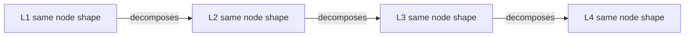

# ICOM+ — fractal function box (Mermaid-native)

> [!NOTE] Reference v0.4 — Hoare fields on irreversible gates
> **ICOM+** = ICOM + process-stack metadata + explicit **Executor** (L4) or
> **Orchestrator** (L1–L3). Static structure (C4 Container, ER) stays **linked
> inset** — not drawn as ICOM+ unless the question is *what function runs here?*
>
> **v0.4:** Irreversible-gate Hoare fields — [icom-plus-irreversible-gates](icom-plus-irreversible-gates.md).
> **REAL** Track B example: [commit-process](../../_playground/l4-models/commit-process/01-validate-batch.md).
> **FICTITIOUS** where marked below.

---

## Two stacks (v0.2 — do not merge)

| Stack | IDs | Question |
| :---- | :-- | :------- |
| **Process** | `app_*` · `proc_*` · `wf_*` · `t_*` | What happens? Who runs/coordinates? |
| **C4 static** | `m_*` (module/Container) · `comp_*` | What exists at deploy/code grain? |

Capability (L1) ≈ app · Process (L2) ≈ module · Workflow (L3) ≈ component grain ·
Task (L4) ≈ code/script sitting. **Link** process boxes to C4 elements in prose;
do not rename C4 diagram levels.

**Governance:** Owner (capability) · Manager (process) · Supervisor (task) ·
Orchestrator (L1–L3 coordination) · Executor (L4 sitting only).

---

## What ICOM+ adds to ICOM

| Field | Required | Levels | Meaning |
| :---- | :------- | :----- | :------ |
| **ID** | yes | all | Prefixed slug — see prefix table |
| **Parent** | yes except L1 | all | Parent box ID (fractal tree) |
| **Function** | yes | all | Short name (≤5 words) — verb + object |
| **Inputs** | yes | all | Artifact · **form** · **where** · **from** executor |
| **Controls** | yes | all | Policy, DMN, Gherkin; **Preconditions** on irreversible-gate tasks |
| **Outputs** | yes | all | Artifact · **form** · **where** · **to** executor |
| **Tools** | yes | all | **External only** — not repo-owned scripts |
| **Measures** | L4 recommended | L4 | Task KPIs (counts, exit codes, traces) |
| **Orchestrator** | L1–L3 | L1–L3 | Who coordinates this scope |
| **Executor** | L4 | L4 | Who runs one sitting |
| **Supervisor** | L4 | L4 | Who accepts output; irreversible gates → human |
| **Postconditions** | irreversible gates | L4 | Evidence table — required when Supervisor holds irreversible gate |
| **Owner** | L1 | L1 | Capability owner |
| **Manager** | L2 | L2 | Process manager |
| **Canon** | L4 required | L4 | `tasks/*.md` or chapter path |
| **Status** | optional | all | `experiment` · `todo` · `doing` · `review` · `done` |

**Form:** `file` · `shell` · `DB entry` · `signal` · `git object`  
**Where:** path · chat · DB name · RAM · ref name

Irreversible-gate **Preconditions** / **Postconditions:** required — see
[icom-plus-irreversible-gates](icom-plus-irreversible-gates.md).

### ID prefixes

| Prefix | Process stack | C4 static |
| :----- | :------------ | :-------- |
| `app_*` | Capability (L1) | System Context app |
| `proc_*` | Process (L2) | — |
| `wf_*` | Workflow (L3) | — |
| `t_*` | Task (L4) | — |
| `exe_*` | Executor | — |
| `m_*` | — | Container (say **module** in prose) |
| `comp_*` | — | Component |
| `act_*` | Actor (edge handoffs) | Context actor |

Diagrams keep C4 label **Container**; book text may say **module**.

**Executor** at L4 only; L1–L3 use **Orchestrator** (decision 2, 2026-06-15).
Repo scripts are **inputs/canon**, not Tools.

---

## Mermaid rules (Obsidian-compatible)

1. **Diagram type:** `flowchart TB` or `flowchart LR` only (stable in Obsidian).
2. **One node = one ICOM+ box.** Multiline label inside `["..."]` with `<br/>`.
3. **Node ID pattern:** `fb_L{n}_{slug}` — e.g. `fb_L4_task01`.
4. **Level band:** wrap same-level nodes in `subgraph L3_id["L3 · parent-name"]`.
5. **Decomposition edges:** parent → child; label `decomposes`.
6. **Handoff edges:** child → child; label = **output name** → next **input**.
7. **Feedback edges:** dashed `-.->` with label `rework`.
8. **Node label template** (copy exactly, fill rows):

```text
<b>ICOM+ L{n} · {slug}</b><br/>
<b>Fn:</b> {Function name}<br/>
<b>In:</b> {comma-separated inputs}<br/>
<b>Ctl:</b> {controls}<br/>
<b>Out:</b> {outputs}<br/>
<b>Mech:</b> {external tools only}<br/>
<b>Orch:</b> {orchestrator — L1-L3 only}<br/>
<b>Exec:</b> {executor — L4 only}<br/>
<b>Sup:</b> {supervisor — L4 only}
```

9. **Title** (prose above diagram): state the **question**, not the notation.
10. **≤15 nodes** per diagram (L3 budget from research seed).
11. **Color = role only** — use [color map](icom-plus-convention.md#color-map-roles) `classDef`s; embed
    a one-line legend under every colored diagram.

---

## Color map (roles)

Consistent across Track B diagrams. **Non-color fallback:** prefix the role in
the node label (`[Owner]`, `[Exec:agent]`, etc.) — required for print and ESL.

| Role | Meaning | Fill | Stroke | `classDef` | Label fallback |
| :--- | :------ | :--- | :----- | :--------- | :------------- |
| **Owner** | L1 capability owner | `#1e3a5f` | `#0f172a` | `roleOwner` | `[Owner]` |
| **Manager** | L2 process manager | `#5b2d8e` | `#3b0764` | `roleManager` | `[Manager]` |
| **Orchestrator** | L1–L3 coordinator | `#0d6e6e` | `#134e4a` | `roleOrch` | `[Orch]` |
| **Executor (human)** | L4 human sitting | `#2d6a4f` | `#1b4332` | `roleExecHuman` | `[Exec:human]` |
| **Executor (agent)** | L4 agent sitting | `#b45309` | `#92400e` | `roleExecAgent` | `[Exec:agent]` |
| **Supervisor / gate** | Accepts output; irreversible | `#9f1239` | `#881337` | `roleSupGate` | `[Sup:gate]` |
| **Actor** | Context actor (edge) | `#6b7280` | `#374151` | `roleActor` | `[Actor]` |
| **Tool** | External tool (legend only) | `#e5e7eb` | `#9ca3af` | `roleTool` | `(tool)` |

**Subgraph bands** (workflow / process scope) — light fill, orchestrator stroke:

| Scope | Subgraph fill | Subgraph stroke |
| :---- | :------------ | :-------------- |
| L3 `wf_*` | `#ecfdf5` | `#0d6e6e` |
| L2 `proc_*` | `#f5f3ff` | `#5b2d8e` |

**Copy-paste** `classDef` block (Obsidian Mermaid):

```mermaid
%%{init: {'theme':'base'}}%%
flowchart LR
    classDef roleOwner fill:#1e3a5f,stroke:#0f172a,color:#fff
    classDef roleManager fill:#5b2d8e,stroke:#3b0764,color:#fff
    classDef roleOrch fill:#0d6e6e,stroke:#134e4a,color:#fff
    classDef roleExecHuman fill:#2d6a4f,stroke:#1b4332,color:#fff
    classDef roleExecAgent fill:#b45309,stroke:#92400e,color:#fff
    classDef roleSupGate fill:#9f1239,stroke:#881337,color:#fff,stroke-width:2px
    classDef roleActor fill:#6b7280,stroke:#374151,color:#fff
    classDef roleTool fill:#e5e7eb,stroke:#9ca3af,color:#1f2937
```

Apply: `nodeId:::roleExecAgent` or `class t01,t02 roleExecAgent`.

**Rules**

- Color the **executor** on L4 task nodes; use `roleSupGate` when the task is an
  irreversible human gate (review approve, merge, deploy).
- L2/L3 **parent boxes** use `roleManager` / `roleOrch` when drawn as nodes.
- Never color by chapter, file type, or diagram family — **role only**.


## Examples

| Set | File | Content |
| :-- | :--- | :------ |
| A–E | [icom-plus-examples](icom-plus-examples.md) | Fictitious L1–L4 + Kanban |
| F–G | [icom-plus-examples-trackb](icom-plus-examples-trackb.md) | REAL `wf_commit_process` + `wf_session_close` |

---
## Fractal rule summary



- **L1–L3:** Orchestrator coordinates; **L4:** Executor runs one sitting.
- **Structured orchestration (Dijkstra):** multi-agent work splits across task
  files with explicit Outputs → Inputs handoff — no ad-hoc agent chains in prose.
  One Executor per task sitting; see [Ch. 04](../../04-your-agents/README.md).
- **Same** I/C/Ctl/O/Tools shape at every level; **different** granularity.
- **Level** in the node title — never omit.
- **Parent** in prose table — never orphan L4 without L3 parent on same page or link.
- **Static map** (C4 Container): link from Tools or Inputs, do not redraw as a
  second grammar on the same canvas.

---

## Follow-up (post-promotion)

- [ ] Replace orphan `icom/task-01.html` with ICOM+ Mermaid in task file

---

## History

| updated_at | Change |
| :--------- | :----- |
| 2026-06-28T23:45:00 | v0.4 — Hoare gates; detail in [icom-plus-irreversible-gates](icom-plus-irreversible-gates.md) |
| 2026-06-15T17:00:00 | v0.3 — color map, Example G, Orchestrator/Executor split |
| 2026-06-12T20:00:00 | v0.1 — promoted from `_playground/` |
