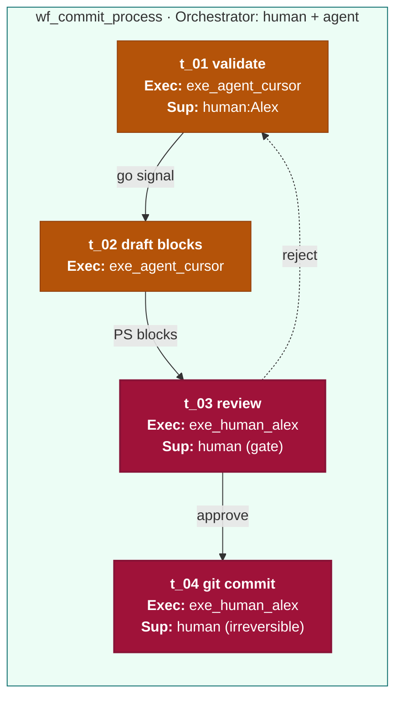
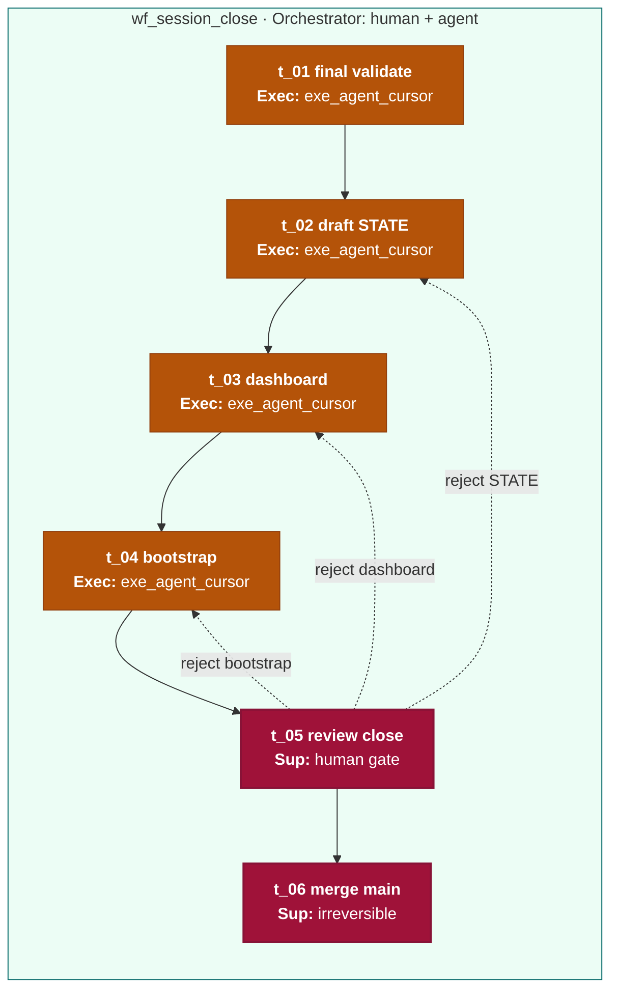

# ICOM+ examples F–G — Track B REAL

> [!NOTE] Verified in Obsidian 2026-06-15
> Convention: [[icom-plus-convention]] · Taxonomy: [[diagram-taxonomy]].

---

## Example F — L3/L4 REAL Track B (`wf_commit_process`)

**Question:** How does one logical commit batch leave the agent and land on the
session branch?

**Stack:** `app_book_harness` → `proc_session_build` → `wf_commit_process` →
`t_01`…`t_04`. Full prose boxes:
[[_playground/l4-models/commit-process/L1-cap-session-governance|L1]] ·
[[_playground/l4-models/commit-process/L2-proc-session-build|L2]] ·
[[_playground/l4-models/commit-process/L3-commit-process|L3]] ·
[[_playground/l4-models/commit-process/01-validate-batch|L4 reference]].

Legend: amber = agent executor · rose = human gate · green stroke band = workflow.

**C4 link:** `m_book_repo` (Container), `m_scripts` (validator module).  
**Auditing:** model as a normal `t_*` task when needed — no special box type.

---

## Example G — L3/L4 REAL Track B (`wf_session_close`)

**Question:** How does a session branch close and merge to `main`?

**Stack:** `app_book_harness` → `proc_session_close` → `wf_session_close` →
`t_01`…`t_06`. Full prose boxes: [[_playground/l4-models/session-close/README|session-close/]].

Legend: amber = agent executor · rose = human gate · maps to [[session-workflow]]
close checklist A→E.

**Parent process:** `proc_session_close` (`roleManager` if drawn as L2 node).
**Precondition:** `wf_commit_process` complete on session branch.

