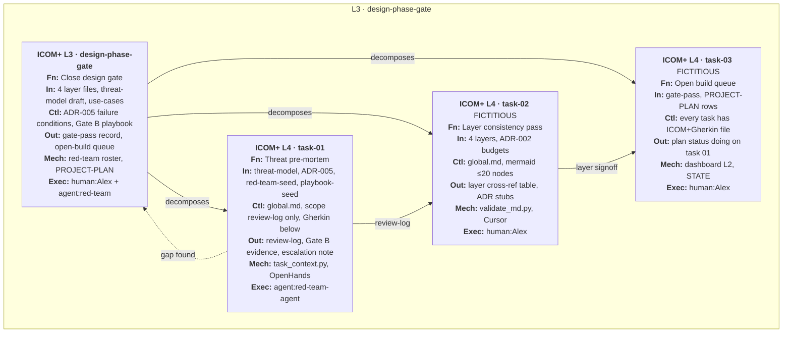
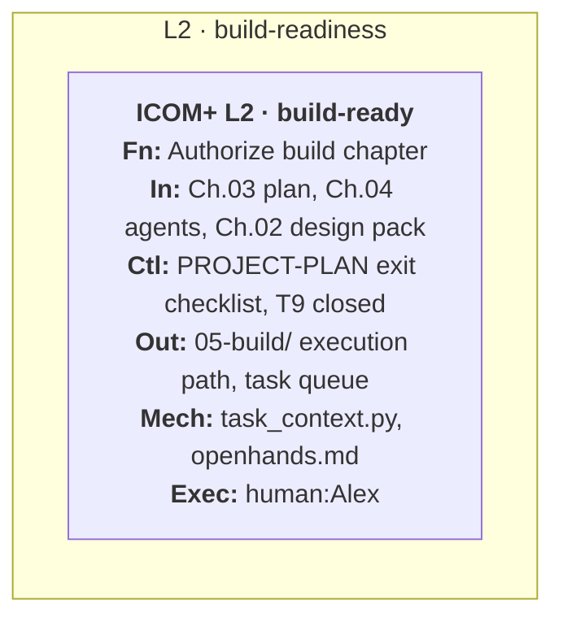
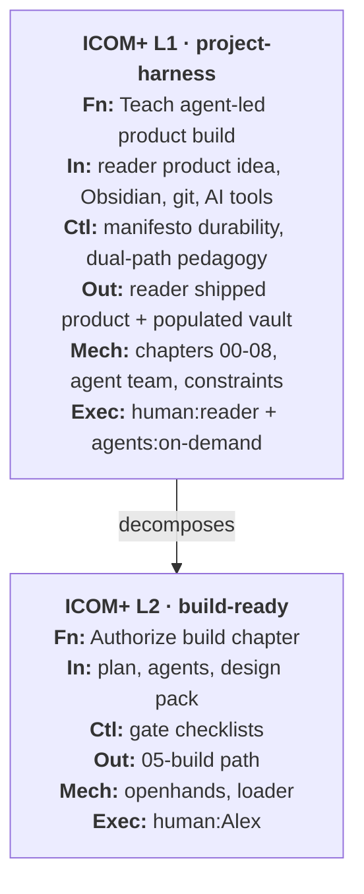
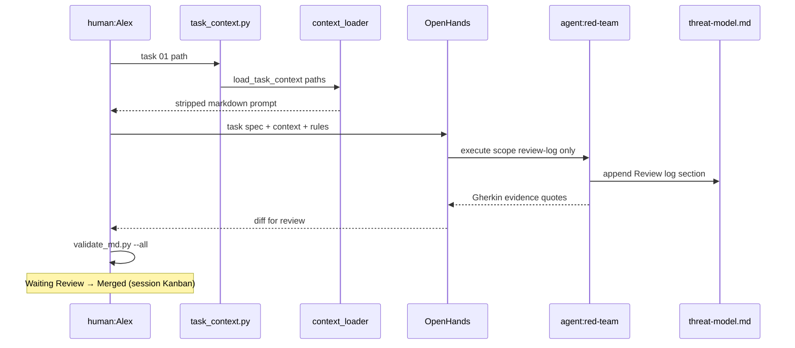

# ICOM+ examples A–E

> [!NOTE] Fictitious teaching examples (except task-01 in Example A)
> Convention rules: [icom-plus-convention](icom-plus-convention.md). Track B REAL: [icom-plus-examples-trackb](icom-plus-examples-trackb.md).

---

## Example A — L3 workflow (design-phase gate)

**Question:** How does the harness exit design before Ch. 05 build?

**Parent:** `fb_L2_build-ready` (L2 — fictitious shell; see Example B)



### ICOM+ tables (L3 parent — full detail)

**`fb_L3_gate` — Close design gate**

| Field | Value |
| :---- | :---- |
| Level | L3 |
| Parent | `fb_L2_build-ready` |
| Function | Close design-phase gate (Gate B) |
| Inputs | `02-design/layers/data.md`, `application.md`, `ux.md`, `communication.md`; `02-design/threat-model.md`; `01-understand/use-cases.md` |
| Controls | `research/lifecycle-playbook-seed.md` Gate B; [ADR-005-failure-condition-convention](../../02-design/decisions/ADR-005-failure-condition-convention.md); no implementation until gate pass |
| Outputs | Gate pass/fail with evidence; updated `03-plan/PROJECT-PLAN.md` exit checklist; authorization to queue Ch. 05 tasks |
| Mechanisms | Five-agent yaml roster; `scripts/validate_md.py --all`; dashboard L2 chapter table |
| Executor | `human:Alex` orchestrates; `agent:red-team-agent` owns threat-model lane |
| Canon | *(fictitious shell — promote to `03-plan/` gate section)* |

**`fb_L4_t01` — Threat pre-mortem (REAL)**

| Field | Value |
| :---- | :---- |
| Level | L4 |
| Parent | `fb_L3_gate` |
| Function | Threat-model pre-mortem review |
| Inputs | `02-design/threat-model.md`; `02-design/decisions/ADR-005-failure-condition-convention.md`; `research/red-team-seed.md`; `research/lifecycle-playbook-seed.md` |
| Controls | [global](../../03-plan/constraints/global.md); **Scope — modify:** `02-design/threat-model.md` (review-log only); read-only: use-cases, PROJECT-PLAN, red-team-agent.yaml |
| Outputs | `## Review log` dated entry; Gate B pass/fail per item; escalation if must-have control missing |
| Mechanisms | `python scripts/task_context.py 04-your-agents/tasks/01-threat-model-premortem.md`; [openhands](../../05-build/execution-tools/openhands.md) |
| Executor | `agent:red-team-agent` (model: `frontier-llm`) |
| Canon | `04-your-agents/tasks/01-threat-model-premortem.md` |

**Gherkin (canon — pairs with box, not inside node):**

```gherkin
Scenario: Threat-model pre-mortem completes
  Given the threat-model crown-jewels and AI-specific threat table exist
  When the red-team agent runs the pre-mortem checklist
  Then a dated review-log entry exists in threat-model.md
  And every open abuse case names a detection or recovery control
  And Gate B checklist items are explicitly pass or fail with evidence
```

---

## Example B — L2 function (container grain)

**Question:** What must be true before the reader opens Ch. 05?

**Parent:** `fb_L1_harness` (L1 — Example C)



| Field | Value |
| :---- | :---- |
| Level | L2 |
| Parent | `fb_L1_harness` |
| Function | Authorize Ch. 05 build execution |
| Inputs | `03-plan/PROJECT-PLAN.md` with task rows; `04-your-agents/agents/*.yaml`; design pack (layers + threat-model + ADRs 001–006); merged `05-build/execution-tools/openhands.md` |
| Controls | Ch. 03 exit checklist (ICOM/Gherkin per task, threat-model reviewed, no plan cycles); ADR-006 teaching blocks on dual-purpose files |
| Outputs | Runnable execution path: `task_context.py` → `load_task_context` → OpenHands prompt; task 01 status `todo` → `doing`; dashboard L2 marks Ch. 05 partial |
| Mechanisms | Git branch per session; `validate_md.py --all`; STATE + dashboard close checklist |
| Executor | `human:Alex` (D-001: commits on Windows) |

---

## Example C — L1 function (system context grain)

**Question:** What is the harness book trying to accomplish for the reader?



| Field | Value |
| :---- | :---- |
| Level | L1 |
| Parent | — (root) |
| Function | Teach durable AI-assisted product development |
| Inputs | Reader's product intent; Ch. 01 roles/use-cases; tool setup (Ch. 00); AI design + execution tools |
| Controls | Manifesto antifragility; ADR discipline; global.md AI-execution rules; no vibe-only path |
| Outputs | Working software in reader's repo; documented decisions; learning loop into Ch. 06 |
| Mechanisms | Book-as-folder-structure; five-agent team; `context_loader` / `task_context.py` |
| Executor | `human:reader` leads; `agent:*` executes bounded tasks |

---

## Example D — L4 mechanism trace (same task, sequence view)

ICOM+ box shows **what**; sequence shows **order** inside one sitting (allowed
inset per [model-visualization-seed](../../research/model-visualization-seed.md)).

**Question:** What happens in one Task 01 sitting?



---

## Example E — Session track (same ICOM+ words, Kanban view)

**Question:** Where is this repo session right now? *(Track B — not product BPMN)*

| Backlog | In Progress WIP≤2 | Waiting Review | Merged | Closed |
| :------ | :---------------- | :------------- | :----- | :----- |
| task-02 FICT | **task-01** `fb_L4_t01` Exec: red-team-agent | — | Ch.05 openhands | S11 T9 retrofit |
| taxonomy v0.3 | playground ICOM+ mock | | loader wiring | |

**You are here:** `fb_L4_t01` in **Backlog** column (todo) — same Executor field
as the Mermaid node.

---
