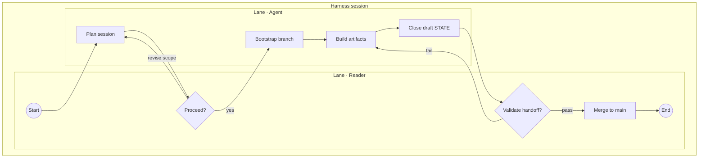
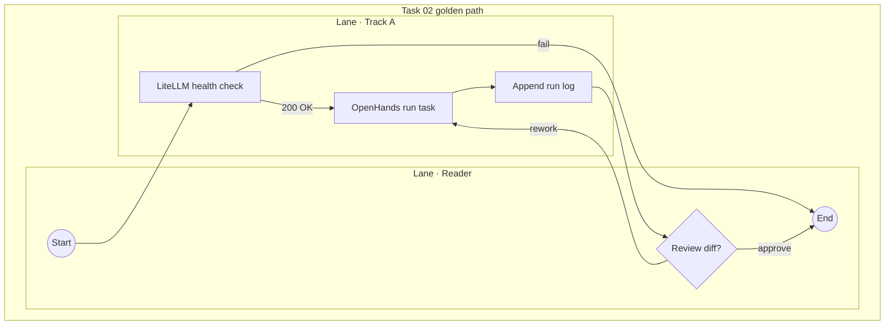

# BPMN 2.0 Process (core subset) — harness examples

**Question answered:** What is the step-by-step flow of a multi-actor harness
scenario?

> [!NOTE] REAL — harness-meta
> Two worked examples — **different questions**, same file. **Variant A** =
> session operations (Track B). **Variant B** = Track A task execution (Task 02).
> Do not place BPMN swimlanes on a C4 Container canvas.

> [!TIP] When to use which
> Draw **Variant A** when the question is how harness *sessions* open, gate, and
> close. Draw **Variant B** when the question is how *Task 02* runs on Track A.

---

## Variant A — session workflow

**Question answered:** How does a harness session move from open to merge?

**Legend**

| Symbol | Role |
| :----- | :---- |
| Circle | Start / end event |
| Box | Task |
| Diamond | XOR gateway — human gate |
| Subgraph | Pool and lane (BPMN subset) |

### Field guide — Variant A

| Step | Meaning |
| :---- | :------- |
| Plan | Agent reads STATE; no branch or edits |
| Proceed | Human confirms scope |
| Bootstrap | Branch + STATE boot line + L3 row |
| Build | Session work on branch |
| Close draft | STATE + dashboard + S(N+1) bootstrap |
| Validate | Human reviews diff + handoff trio |
| Merge | Human git merge to `main` (D-001) |

### ESL checklist — Variant A

| Rule | Pass |
| :---- | :---- |
| Title = question | Session open to merge |
| Labels ≤ 5 words | Yes |
| Embedded legend | Above |
| L3 node budget ≤ 15 | 10 nodes |
| Not on C4 canvas | Standalone process |

---

## Variant B — Track A golden path

**Question answered:** How does Task 02 run through the Track A stack?

**Legend**

| Symbol | Role |
| :----- | :---- |
| Circle | Start / end event |
| Box | Automated or agent task |
| Diamond | Human review gate |

### Field guide — Variant B

| Step | Meaning |
| :---- | :------- |
| LiteLLM health check | Must pass before OpenHands starts |
| OpenHands run task | Dev agent with stripped context |
| Append run log | Scope — modify `openhands.md` only |
| Review diff | Human gate before commit (D-001) |

### ESL checklist — Variant B

| Rule | Pass |
| :---- | :---- |
| Title = question | Task 02 stack flow |
| Labels ≤ 5 words | Yes |
| Embedded legend | Above |
| L3 node budget ≤ 15 | 7 nodes |
| Pairs with ICOM | [task-box](../icom/task-box.md) |

---

## Pairing

| Also draw when | Diagram |
| :------------- | :------ |
| Static modules | [container](../c4/container.md) |
| DMN at gateway | [decision-table](../dmn/decision-table.md) |
| Message-level detail | [sequence](../uml/sequence.md) |
| L3 taxonomy | [diagram-taxonomy-levels](../../context/system/diagram-taxonomy-levels.md#l3-component-workflow) |

## Where to go next

- **BPMN section index:** [README](README.md)
- **Session procedure:** [session-workflow](../../context/system/session-workflow.md)
- **Task 02 canon:** `04-your-agents/tasks/02-track-a-golden-path.md`
