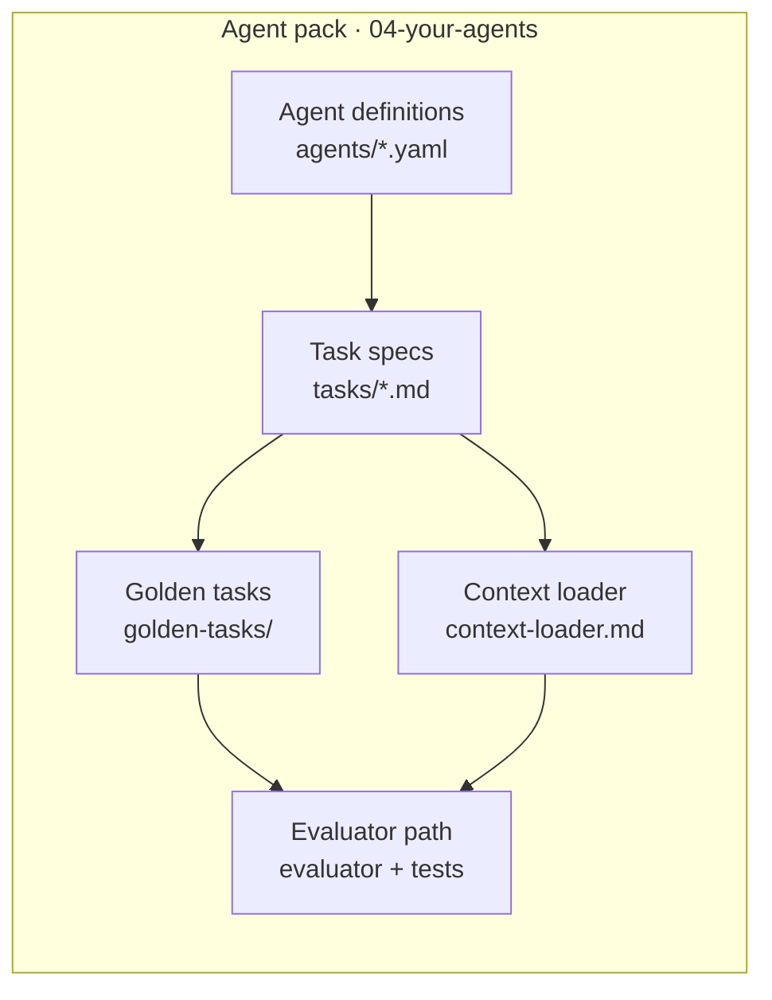

# C4 Component — harness example

**Question answered:** What are the major structural parts inside the Agent
pack container?

> [!NOTE] REAL — harness-meta
> Zooms into **`04-your-agents/`** only. Other containers (spine, meta,
> scripts) stay at [[container]] unless you need their internals too.

## Diagram

**Legend**

| Symbol | Role |
| :----- | :---- |
| Box | Component — structural part inside one container |
| Arrows | Depends on, loads, or validates through |

## Field guide

| Component | In this harness | In your product |
| :-------- | :-------------- | :-------------- |
| Agent definitions | Role yaml (`dev-agent`, etc.) | Agent personas, tool policies |
| Task specs | ICOM+ `tasks/*.md` with `context_load` | Work units with acceptance criteria |
| Golden tasks | Regression fixtures for evaluator | Snapshot / contract tests |
| Context loader | `task_context.py` + [[context-loader]] rules | Prompt assembly, RAG retrieval |
| Evaluator path | `scripts/test_golden_tasks.py` + fog-word lint | Quality gates on agent output |
| Not shown here | Cross-container calls to `scripts/` or Track A | Your API clients — draw at L2 |

## ESL checklist (this file)

| Rule | Pass |
| :---- | :---- |
| Title = question | Parts inside Agent pack |
| Labels ≤ 5 words | Yes |
| Embedded legend | Table above |
| L3 node budget ≤ 15 | 5 components |
| Static only | No numbered sequence |
| One container only | Agent pack boundary respected |

## Pairing

| Also draw when | Diagram |
| :------------- | :------ |
| Container not yet drawn | [[container]] |
| One task's runtime flow | [[../icom/task-box]] or [[../uml/sequence]] |
| Session-level behaviour | [[dynamic]] or [[../bpmn/process-subset]] |

## Where to go next

- **Container (parent):** [[container]]
- **C4 section index:** [[README]]
- **Real L4 task example:** `04-your-agents/tasks/02-track-a-golden-path.md`
- **FICTITIOUS teaching mockup:** `_playground/mockups/c4-component.md`
