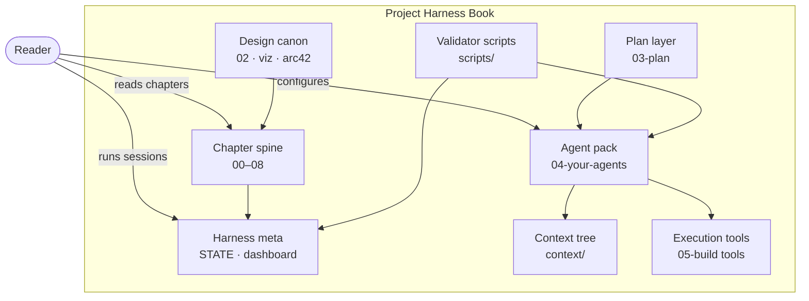

# C4 Container — harness example

**Question answered:** What independently deployable or logically separable
parts make up the project harness book repo?

> [!NOTE] REAL — harness-meta
> Logical **modules** inside this repo — not your product's microservices.
> Say **module** in prose; C4 label stays **Container**.

## Diagram

**Legend**

| Symbol | Role |
| :----- | :---- |
| Rounded person | Human actor outside the system boundary |
| Box | Logical container (module) — independently understandable part |
| Arrows | Primary dependency or read/write relationship |

## Field guide

| Container | In this harness | In your product |
| :-------- | :-------------- | :-------------- |
| Chapter spine | Teaching folders `00`–`08` | Your user-facing app or docs |
| Harness meta | `STATE.md`, `_index/dashboard/`, [[session-workflow]] | Ops runbooks, status boards |
| Agent pack | `agents/*.yaml`, `tasks/`, golden-tasks, evaluator | Your agent config + task specs |
| Context tree | `context/` architecture domains | Your shared context / knowledge base |
| Design canon | `02-design/`, `viz/`, `arc42/` | ADRs, diagrams, design docs |
| Plan layer | `PROJECT-PLAN.md`, `constraints/` | Backlog, constraints registry |
| Validator scripts | `validate_md.py`, pre-commit hooks | CI linters, test runners |
| Execution tools | Track A/B docs, `track-a/` compose | Your deploy stack, IDE tooling |
| Not shown here | Parts inside Agent pack — see [[component]] | Your service internals — L3 |

## ESL checklist (this file)

| Rule | Pass |
| :---- | :---- |
| Title = question | What modules make up harness |
| Labels ≤ 5 words | Yes |
| Embedded legend | Table above |
| L2 node budget ≤ 12 | 8 containers + 1 actor |
| Static only | No numbered sequence; no gateways |
| Container ≠ Deployment | Physical mapping — see [[deployment]] |

## Pairing

| Also draw when | Diagram |
| :------------- | :------ |
| L1 boundary unclear | [[context]] |
| Runtime handoff for one scenario | [[dynamic]] or [[../uml/sequence]] |
| Where modules run | [[deployment]] |
| Inside one module | [[component]] |

## Where to go next

- **Worked L1 example:** [[context]]
- **C4 section index:** [[README]]
- **FICTITIOUS teaching mockup:** `_playground/mockups/c4-container.md`
- **Track A compose (execution slice):** [[track-a-setup]]
