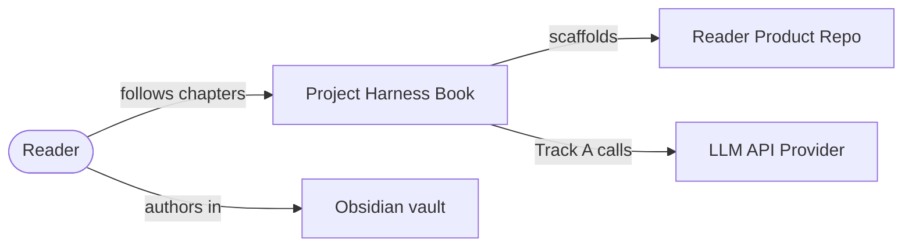

# C4 System Context — harness example

**Question answered:** Who uses the project harness book and which external
systems does it depend on?

> [!NOTE] REAL — harness-meta
> This diagram describes **this repo** (the book-as-harness), not a reader's
> product. Your fork replaces the center system with your product name and
> redraws externals to match your stack.

## Diagram

**Legend**

| Symbol | Role |
| :----- | :---- |
| Rounded person | Human actor |
| Box | Software system (this diagram: one central system) |
| Arrows | Primary relationship — short verb phrase on label |

## Field guide

| Element | In this harness | In your product |
| :------ | :-------------- | :-------------- |
| Central system | Book repo (`00`–`08`, agents, validator) | Your app or service name |
| Human actor | Reader learning the methodology | Your end users or operators |
| External systems | Product repo reader builds; LLM API; Obsidian | Payment, identity, data vendors, etc. |
| Not shown here | Containers inside Harness — see [[container]] | Your modules — L2 |

## ESL checklist (this file)

| Rule | Pass |
| :---- | :---- |
| Title = question | Who uses harness + externals |
| Labels ≤ 5 words | Yes |
| Embedded legend | Table above |
| L1 node budget ≤ 7 | 5 nodes |
| Static only | No numbered sequence; no gateways |

## Pairing

| Also draw when | Diagram |
| :------------- | :------ |
| Wider than one product | C4 System Landscape (taxonomy supplementary) |
| Runtime collaboration | [[dynamic]] or [[../uml/sequence]] |
| Session orientation | Dashboard L1 — not this C4 level ([[diagram-taxonomy#Track B — Session operations]]) |

## Where to go next

- **C4 section index:** [[README]]
- **Dashboard L1 (different zoom):** `_index/dashboard/01-context.md`
- **FICTITIOUS teaching mockup:** `_playground/mockups/c4-system-context.md`
- **Container example (L2):** [[container]]
