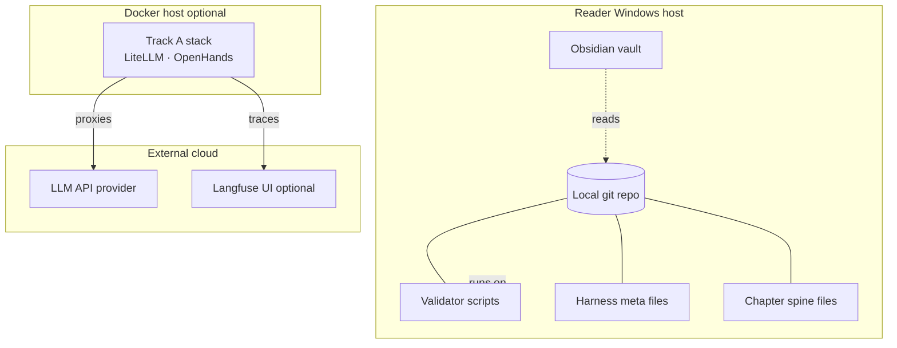

# C4 Deployment — harness example

**Question answered:** Where do harness logical containers run on physical
nodes?

> [!NOTE] REAL — harness-meta
> Maps [[container]] modules to **deployment nodes**. Draw [[container]]
> first; this diagram second — never merge both on one canvas.

## Diagram

**Legend**

| Symbol | Role |
| :----- | :---- |
| Subgraph | Deployment node (machine or environment) |
| Cylinder | Data store (git objects, vault files) |
| Solid line | Hosted on / stored in |
| Dashed line | Optional or read-only sync |

## Field guide

| Node | Containers hosted | In your product |
| :---- | :---------------- | :-------------- |
| Windows host | Git repo, markdown chapters, STATE, dashboard, validator | Developer laptop or CI runner |
| Obsidian vault | May overlap same disk as git clone | Your CMS or wiki mirror |
| Docker host | Execution tools — Track A compose only | K8s cluster, cloud VM |
| LLM cloud | External — not a harness container | Your SaaS dependencies |
| Langfuse | Optional observability for Track A | Your APM / tracing vendor |
| Not shown here | Logical dependencies — see [[container]] | Service mesh at L2 static |

## ESL checklist (this file)

| Rule | Pass |
| :---- | :---- |
| Title = question | Where containers run |
| Labels ≤ 5 words | Yes |
| Embedded legend | Table above |
| Deployment ≠ Container | Separate canvas from [[container]] |
| L2 node budget ≤ 12 | 3 nodes + 6 mapped elements |
| Static only | No numbered sequence |

## Pairing

| Also draw when | Diagram |
| :------------- | :------ |
| Logical modules unclear | [[container]] |
| Track A runtime messages | [[../uml/sequence]] Variant B |
| Session close flow | [[dynamic]] |

## Where to go next

- **Logical containers:** [[container]]
- **Track A compose detail:** [[track-a-setup]]
- **C4 section index:** [[README]]
- **L1 externals:** [[context]]
