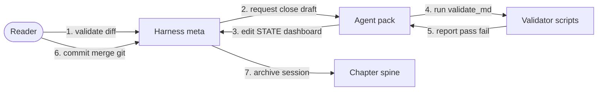

# C4 Dynamic — harness example

**Question answered:** How do harness containers collaborate when a reader
closes a session and merges to `main`?

> [!NOTE] REAL — harness-meta
> Numbered runtime collaboration on **static C4 elements** from [container](container.md).
> Track B session operations — not product L1–L4 behaviour.

## Diagram

**Legend**

| Symbol | Role |
| :----- | :---- |
| Numbered arrow | Order of collaboration for this scenario |
| Box | Same containers as [container](container.md) — not new elements |
| Person | Human gate (D-001 git on Windows) |

## Field guide

| Step | In this harness | In your product |
| :---- | :-------------- | :-------------- |
| 1 | Human reviews work diff + handoff docs | Code review / PR approval |
| 2 | Agent runs close checklist on session branch | CI pipeline or release bot |
| 3 | STATE + dashboard L1–L3 updated | Status page, changelog |
| 4 | `python scripts/validate_md.py --all` | Test + lint suite |
| 5 | Zero failures required before merge offered | Green build gate |
| 6 | Human runs git commit + merge (D-001) | Deploy or merge to trunk |
| 7 | Session prose may land in chapter or session-docs | Release notes |
| Not shown here | BPMN gateways — see [process-subset](../bpmn/process-subset.md) | Full workflow notation |

## ESL checklist (this file)

| Rule | Pass |
| :---- | :---- |
| Title = question | Session close collaboration |
| Labels ≤ 5 words | Yes |
| Embedded legend | Table above |
| Uses existing C4 elements | Yes — from [container](container.md) |
| Supplementary only | Does not replace static Container |
| Node budget | 5 containers + 1 actor |

## Pairing

| Also draw when | Diagram |
| :------------- | :------ |
| Structure not drawn yet | [container](container.md) |
| Full gateway logic needed | [process-subset](../bpmn/process-subset.md) Variant A |
| Message-level timing | [sequence](../uml/sequence.md) Variant A |
| Irreversible gate rules | [decision-table](../dmn/decision-table.md) Variant A |

## Where to go next

- **Static containers:** [container](container.md)
- **Session procedure:** [session-workflow](../../context/system/session-workflow.md)
- **C4 section index:** [README](README.md)
- **UML sequence alternative:** [sequence](../uml/sequence.md)
