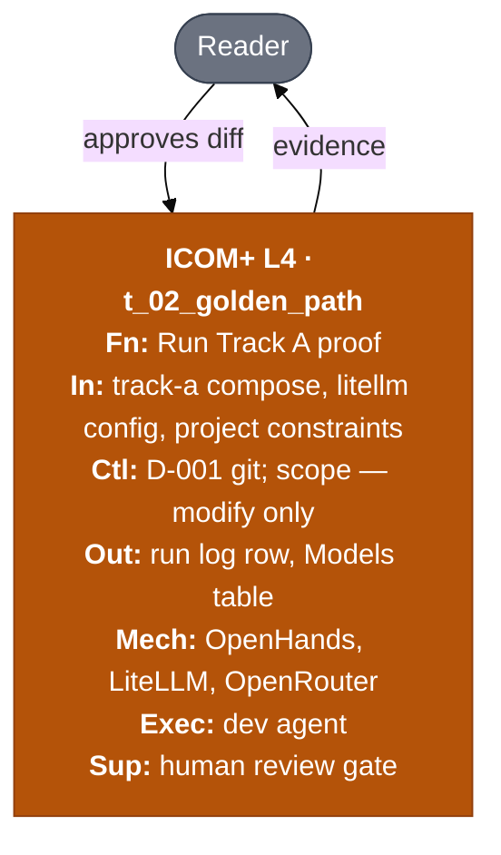

# ICOM+ task box — harness example

**Question answered:** What does Task 02 (Track A golden-path run) accept,
obey, produce, and who executes it?

> [!NOTE] REAL — harness-meta
> **View** of [04-your-agents/tasks/02-track-a-golden-path.md](../../04-your-agents/tasks/02-track-a-golden-path.md).
> Canon task file stays source of truth; this diagram is the L4 box rendering.

## Diagram

**Legend**

| Color / prefix | Role |
| :------------- | :---- |
| Orange (`roleExecAgent`) | L4 executor — dev agent runs one sitting |
| Red stroke (`roleSupGate`) | Supervisor holds irreversible human gate |
| Gray (`roleActor`) | Human actor at context edge |

## Field guide

| Field | In this harness (Task 02) | In your product task |
| :---- | :------------------------ | :------------------- |
| **ID** | `t_02_golden_path` | `t_*` prefixed slug |
| **Inputs** | Stack docs, compose, litellm yaml, constraints | Artifacts with form + where |
| **Controls** | Scope — modify; D-001; stack rules | Policies, Gherkin, preconditions |
| **Outputs** | `openhands.md` log row; `project.md` Models table | Deliverables with destination paths |
| **Tools** | OpenHands, LiteLLM, OpenRouter (external only) | SaaS APIs — not repo scripts |
| **Executor** | dev agent via Track A | Your agent or human role |
| **Supervisor** | Human reviews diff before commit | Approver on irreversible gate |
| **Canon** | `04-your-agents/tasks/02-track-a-golden-path.md` | `tasks/*.md` path |

## ESL checklist (this file)

| Rule | Pass |
| :---- | :---- |
| Title = question | Task 02 I/O and roles |
| Labels ≤ 5 words | Yes |
| Embedded legend | Table above |
| Color = role only | ICOM+ color map applied |
| L4 executor on task node | `roleExecAgent` |
| External tools only in Mech | OpenHands stack — not `task_context.py` |

## Pairing

| Also draw when | Diagram |
| :------------- | :------ |
| Track A message order | [sequence](../uml/sequence.md) Variant B |
| Track A vs B choice | [decision-table](../dmn/decision-table.md) Variant B |
| Agent pack structure | [component](../c4/component.md) |
| Full convention | [icom-plus-convention](../../_playground/icom-plus-convention.md) |

## Where to go next

- **Canon task file:** `04-your-agents/tasks/02-track-a-golden-path.md`
- **ICOM+ section index:** [README](README.md)
- **Template:** `_templates/new-task.md`
- **Track A setup:** [track-a-setup](../../05-build/execution-tools/track-a-setup.md)
