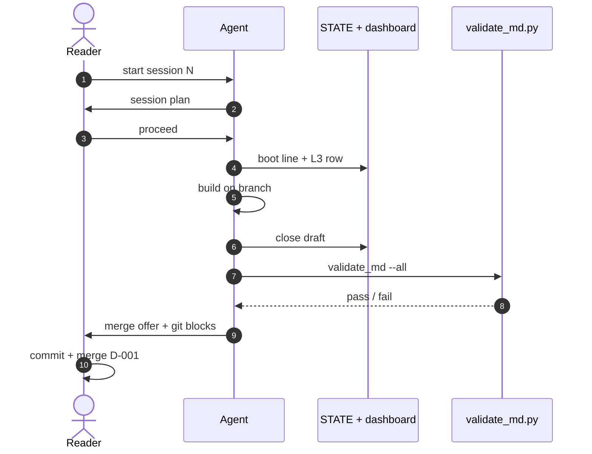
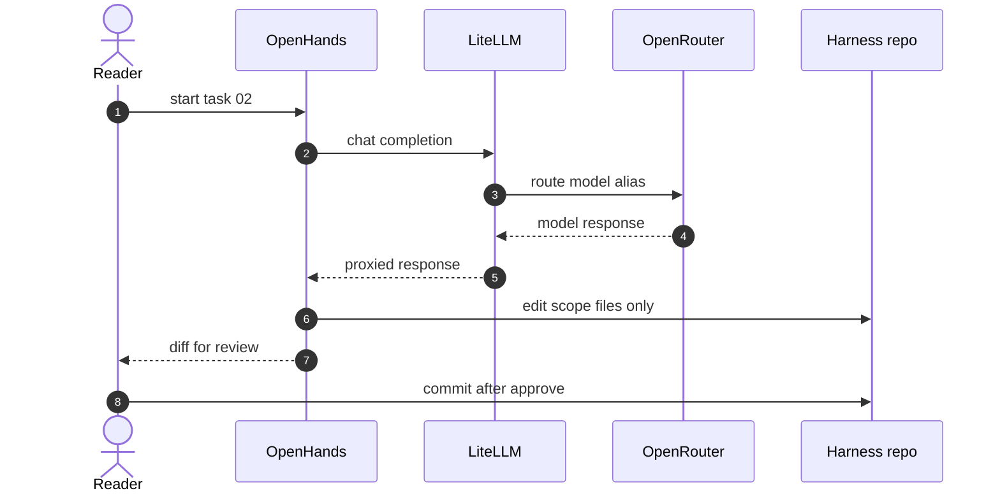

# UML Sequence — harness examples

**Question answered:** In what order do actors and systems exchange messages
during a harness scenario?

> [!NOTE] REAL — harness-meta
> Two worked examples — **different questions**, same file. **Variant A** =
> session close handoff (Track B). **Variant B** = Task 02 message trace on Track A.
> Mermaid `sequenceDiagram` syntax (UML sequence subset).

> [!TIP] When to use which
> Use **Variant A** for session Plan → Validate message order. Use **Variant B**
> for OpenHands + LiteLLM + repo edits during Task 02.

---

## Variant A — session workflow handoff

**Question answered:** Who messages whom during session close validation?

**Legend**

| Symbol | Role |
| :----- | :---- |
| `actor` | Human outside the system |
| `participant` | Logical system or script |
| `autonumber` | Ordered messages for this scenario |
| Solid arrow | Request; dashed = return |

### Field guide — Variant A

| Message | Meaning |
| :------ | :------ |
| Session plan | Plan phase — no edits yet |
| Proceed | Human gate unlocks Execute |
| Close draft | Handoff trio before merge offer |
| validate_md | Evidence gate — zero failures |
| D-001 | Git on Windows host only |

### ESL checklist — Variant A

| Rule | Pass |
| :---- | :---- |
| Title = question | Session close message order |
| Labels ≤ 5 words | Yes |
| Embedded legend | Above |
| L3/L4 boundary | Session ops (Track B) |

---

## Variant B — Task 02 Track A trace

**Question answered:** What messages flow when OpenHands runs Task 02?

**Legend**

| Symbol | Role |
| :----- | :---- |
| OpenHands | Track A executor container |
| LiteLLM | Proxy — never bypass |
| OpenRouter | External LLM routing |
| Repo | Scope — modify files only |

### Field guide — Variant B

| Message | Meaning |
| :------ | :------ |
| LiteLLM health | Prerequisite before step 1 (see [[task-box]]) |
| Scope files only | `openhands.md` log + `project.md` Models |
| Diff for review | Human gate — no agent commit |
| Virtual key | OpenHands uses LiteLLM virtual key |

### ESL checklist — Variant B

| Rule | Pass |
| :---- | :---- |
| Title = question | Task 02 message trace |
| Labels ≤ 5 words | Yes |
| Embedded legend | Above |
| Pairs with ICOM | [[../icom/task-box]] |

---

## Pairing

| Also draw when | Diagram |
| :------------- | :------ |
| C4 runtime on boxes | [[../c4/dynamic]] |
| Gateway branching | [[../bpmn/process-subset]] |
| State machines | [[state]] |
| Deployment nodes | [[../c4/deployment]] |

## Where to go next

- **UML section index:** [[README]]
- **C4 Dynamic alternative:** [[../c4/dynamic]]
- **Track A setup:** [[track-a-setup]]
