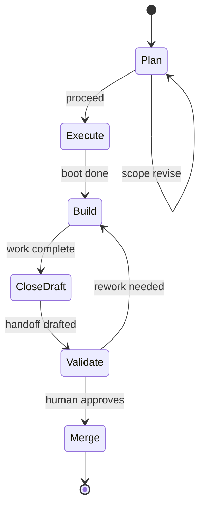
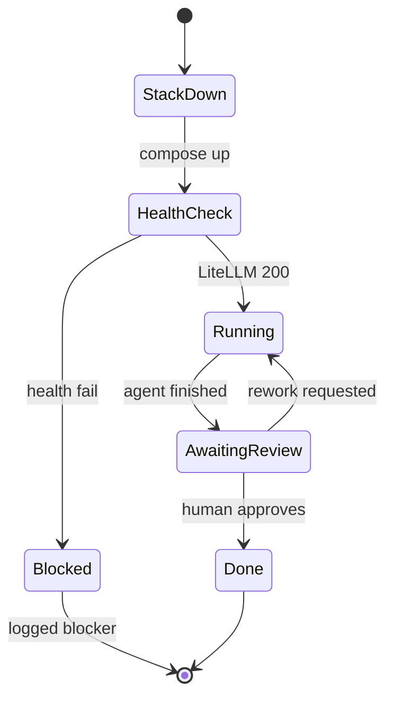

# UML State — harness examples

**Question answered:** What states can a harness workflow be in, and which
transitions are valid?

> [!NOTE] REAL — harness-meta
> Two worked examples — **different questions**, same file. **Variant A** =
> session state machine (Track B). **Variant B** = Task 02 execution states.
> Mermaid `stateDiagram-v2` syntax (UML state subset).

> [!TIP] When to use which
> Use **Variant A** for valid session phases and transitions. Use **Variant B**
> for Task 02 stack health, run, review, and blocked paths.

---

## Variant A — session state machine

**Question answered:** What states does a harness session pass through?

**Legend**

| Symbol | Role |
| :----- | :---- |
| `[*]` | Initial / final pseudo-state |
| Named state | Stable phase with entry evidence |
| Arrow label | Guard or trigger for transition |

### Field guide — Variant A

| State | Evidence of entry |
| :---- | :---------------- |
| Plan | Session plan in chat; no branch |
| Execute | Boot line in STATE + L3 row |
| Build | Edits on session branch |
| CloseDraft | STATE + dashboard + bootstrap drafted |
| Validate | Human reviewing diff + handoff |
| Merge | `validate_md.py --all` green; human git |

### ESL checklist — Variant A

| Rule | Pass |
| :---- | :---- |
| Title = question | Session state machine |
| Labels ≤ 5 words | Yes |
| Embedded legend | Above |
| Matches session-workflow | [[session-workflow#Structured flow (state and evidence)]] |

---

## Variant B — Task 02 execution states

**Question answered:** What states does Task 02 pass through on Track A?

**Legend**

| Symbol | Role |
| :----- | :---- |
| Blocked | Environment gate — documented blocker path |
| AwaitingReview | Irreversible human supervisor gate |
| Done | Run log + Models table updated |

### Field guide — Variant B

| State | Evidence |
| :---- | :------- |
| StackDown | Compose not healthy yet |
| HealthCheck | LiteLLM endpoint responding |
| Running | OpenHands executing with stripped context |
| AwaitingReview | Diff ready; D-001 applies |
| Blocked | Second Gherkin scenario in task 02 |
| Done | Acceptance criteria satisfied |

### ESL checklist — Variant B

| Rule | Pass |
| :---- | :---- |
| Title = question | Task 02 state machine |
| Labels ≤ 5 words | Yes |
| Embedded legend | Above |
| Pairs with BPMN B | [[../bpmn/process-subset]] Variant B |

---

## Pairing

| Also draw when | Diagram |
| :------------- | :------ |
| Ordered messages | [[sequence]] |
| Process with lanes | [[../bpmn/process-subset]] |
| C4 numbered collab | [[../c4/dynamic]] |
| Gateway decision table | [[../dmn/decision-table]] |

## Where to go next

- **UML section index:** [[README]]
- **Task 02 canon:** `04-your-agents/tasks/02-track-a-golden-path.md`
- **Session workflow states:** [[session-workflow]]
